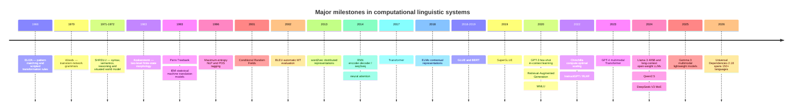
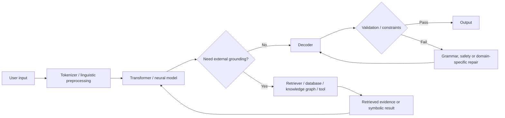

# Classic and Modern Computational Linguistic Systems: Architectures, Evaluation, Linguistic Coverage, Compute, and Risk

## Executive summary

Computational linguistics has moved through several overlapping paradigms rather than a simple sequence of replacements. **Rule-based and symbolic systems** represented linguistic knowledge explicitly through grammars, lexicons, logical predicates, pattern-action rules, and procedural semantic representations. ELIZA (1966), augmented transition networks around 1970, SHRDLU (1971–72), and two-level finite-state morphology (1983) illustrate different points on this spectrum. These systems offered unusually transparent linguistic analyses and could be highly reliable inside well-defined domains, but their coverage generally depended on expensive manual knowledge engineering and they degraded sharply when confronted with constructions, domains, or world knowledge not anticipated by their designers. citeturn130712search3turn130712search19turn130712search5turn619041search3

The **statistical NLP era** shifted the engineering bottleneck from hand-written rules toward corpora, feature design, probabilistic estimation, and supervised annotation. IBM statistical machine-translation models, maximum-entropy taggers, probabilistic parsers, hidden Markov models, and conditional random fields made uncertainty explicit and enabled reproducible evaluation on shared corpora such as the Penn Treebank. They scaled better to lexical variation than purely symbolic systems, but still depended heavily on manually designed features, annotated datasets, Markov or conditional-independence assumptions, and task-specific pipelines. citeturn619041search1turn904315search0turn577942search6turn130712search4

The **neural transition** initially replaced feature engineering with learned distributed representations. Word2vec showed that useful syntactic and semantic regularities could be learned efficiently from billions of tokens; recurrent encoder–decoder models then learned end-to-end sequence mappings, and attention mitigated the fixed-vector bottleneck in early neural machine translation. ELMo subsequently demonstrated that contextual representations could encode both syntactic and semantic information in different neural layers. citeturn577942academia8turn577942academia9turn904315academia37turn577942search4

The 2017 **Transformer** radically improved parallelism by replacing recurrence with self-attention; BERT then established large-scale bidirectional pretraining for language understanding, while GPT-3 demonstrated that sufficiently scaled autoregressive models could acquire useful task behavior through prompts rather than gradient-based task adaptation. Scaling studies such as Chinchilla subsequently showed that parameter count alone is a poor proxy for computational efficiency: at the same training-compute budget, a 70B-parameter model trained on far more tokens substantially outperformed the 280B-parameter Gopher model. citeturn853570academia5turn853570search1turn853570search2turn853570academia7

Modern **large language models are unusually broad computational linguistic systems**, but breadth should not be confused with uniform linguistic competence. They handle syntax, lexical semantics, morphology, translation, question answering, many discourse patterns, and some pragmatic inference far better than older general-purpose systems; nevertheless, benchmark accuracy can conceal brittle behavioral failures, prompt sensitivity, hallucination, failure under distribution shift, and incomplete pragmatic grounding. CheckList demonstrated significant failures in state-of-the-art and commercial NLP models despite strong held-out accuracy, while MMLU itself measures broad task competence rather than a theory-complete notion of linguistic understanding. citeturn171024search1turn420172academia32

The strongest contemporary engineering pattern is therefore increasingly **hybrid**: neural models provide flexible representation and generation, while retrieval systems, databases, tools, finite-state constraints, symbolic validators, structured decoders, or external programs provide explicit knowledge, provenance, control, or exact computation. Retrieval-Augmented Generation is a canonical example: it combines a pretrained sequence model with an explicit non-parametric document index, improving knowledge-intensive task performance while making knowledge easier to update and potentially providing evidence provenance. citeturn822512search2

The central historical trade-off can be stated succinctly: **explicit linguistic structure maximizes control and interpretability; statistical learning increases coverage and uncertainty handling; deep learning maximizes representation learning and task breadth; large pretrained transformers maximize transfer and generative flexibility; hybrid systems attempt to recover explicit control and external grounding without sacrificing neural generality.** No paradigm dominates every dimension.

## Historical evolution and major milestones

The following timeline emphasizes conceptual transitions rather than claiming that one paradigm disappeared when another emerged. Finite-state morphology, CRFs, symbolic grammars, and hand-written constraints remain useful components in contemporary systems, including neural pipelines. citeturn619041search3turn904315search26

The milestones correspond to original papers or official project documentation: Weizenbaum's ELIZA appeared in *Communications of the ACM* in January 1966; Woods' transition-network work was published in 1970; Winograd's SHRDLU dissertation appeared as MIT AI Technical Report 235 in 1971 and as *Understanding Natural Language* in 1972; Koskenniemi's two-level morphology appeared in 1983; the Penn Treebank and IBM statistical MT work appeared in 1993. citeturn130712search3turn130712search19turn130712search5turn619041search3turn130712search4turn619041search1

The modern sequence is similarly well documented: word2vec in 2013, seq2seq and neural attention in 2014, the Transformer in 2017, ELMo in 2018, BERT in 2018/2019, GPT-3 in 2020, Chinchilla and InstructGPT in 2022, and subsequent large-scale Transformer families. citeturn577942academia8turn577942academia9turn904315academia37turn853570academia5turn577942search4turn853570search1turn853570search2turn853570academia7turn822512search3

More recent examples demonstrate architecture diversification rather than simple dense scaling. Meta's Llama 3 report describes a dense 405B-parameter Transformer with a context window up to 128K tokens; Qwen2.5 reports pretraining over 18 trillion tokens; DeepSeek-V3 uses a 671B-total-parameter mixture-of-experts model with 37B parameters activated per token and reports 14.8 trillion pretraining tokens; Gemma 3 combines multimodality, long context and local/global attention in models from 1B to 27B parameters. citeturn819062search0turn819062academia5turn819062academia6turn819062academia7

## Classical symbolic and finite-state systems

### Rule-based pattern systems and symbolic dialogue

ELIZA is an archetypal rule-driven language system. Its behavior was produced through scripts containing keyword priorities, decomposition patterns, transformation rules, and reassembly patterns rather than a learned probabilistic model. This made its operational behavior inspectable and inexpensive by contemporary standards, but its apparent conversational competence depended heavily on the structure of the interaction and did not constitute broad semantic or pragmatic understanding. citeturn130712search3turn130712search48

SHRDLU represented a much more ambitious symbolic architecture. It coupled a parser, semantic interpretation, procedural knowledge, a planner, deduction mechanisms, and a simulated "blocks world." The system's striking linguistic performance depended precisely on restricting discourse to an environment in which entities, relations and possible actions could be explicitly represented. citeturn130712search5turn130712search33

Augmented transition networks represented grammatical analysis as networks whose arcs could carry tests and structure-building actions. Woods explicitly designed the formalism to permit syntactic restructuring and to exploit semantic information while parsing. Such systems can directly encode grammatical theory, but grammar development and maintenance become increasingly difficult as lexical, constructional and domain coverage expand. citeturn130712search19

### Finite-state morphology

Koskenniemi's two-level morphology represented correspondences between lexical and surface forms using parallel finite-state automata. The same description could be applied analytically or generatively, making the formalism particularly suitable for morphologically rich languages. The original work explicitly targeted languages including Finnish, Russian and Sanskrit. citeturn619041search3turn619041search2

Finite-state systems remain compelling because regular relations admit highly efficient compilation and inference, and morphological outputs can be linguistically interpretable. The important qualification is that "finite-state" does not automatically imply trivial computational complexity in every formulation; theoretical analysis of two-level morphology demonstrated that particular recognition and generation problems can still become computationally difficult depending on dictionary and rule interaction. citeturn619041search6

| Classical system/type | Core mechanism | Linguistic strengths | Principal weaknesses | Resources and scalability | Interpretability / robustness | Ethical and privacy profile |
|---|---|---|---|---|---|---|
| Pattern-action systems, e.g. ELIZA | Ordered keyword rules, pattern decomposition and response transformation. citeturn130712search3 | Surface morphology, lexical triggers, local dialogue patterns | Essentially no open-domain semantic model; weak reference, world knowledge and discourse state | Tiny compute; human rule-writing cost dominates | Very high local interpretability; brittle outside scripted patterns | Little training-data privacy exposure, but designer assumptions and stereotypes may be directly encoded |
| Symbolic grammars / ATNs | Explicit grammar networks, registers/tests, transformations. citeturn130712search19 | Syntax and compositional structure can be represented explicitly | Lexical ambiguity, broad coverage and grammar maintenance become expensive | Runtime can be modest; authoring cost grows sharply with grammar breadth | High explanation potential; robustness generally bounded by grammar coverage | Bias primarily enters through grammar, lexicon and application logic rather than massive scraped corpora |
| SHRDLU-style integrated symbolic semantics | Grammar + semantic procedures + theorem proving/planning + world model. citeturn130712search5 | Strong compositional semantics, reference and pragmatic action inside a restricted world | Domain transfer poor; ontology and commonsense knowledge must be engineered | Low hardware needs by modern standards; very high knowledge-engineering cost | High causal traceability relative to neural models; reliable only where ontology is adequate | Narrow data collection reduces some privacy exposure; ontology choices can encode normative assumptions |
| Finite-state morphology | Finite-state automata/transducers over lexical–surface correspondences. citeturn619041search3 | Excellent inflection, derivation, token analysis and generation when rules are known | Syntax, discourse, pragmatics and unrestricted semantics fall outside the core formalism | Extremely attractive for large lexicons and high-throughput analysis; description creation remains manual | Highly inspectable and deterministic; very robust for covered forms | Low intrinsic privacy risk; language-resource ownership and representational coverage remain concerns |

A recurring lesson from these systems is that **knowledge representation and linguistic competence were tightly coupled**. Their failures were usually inspectable: a missing lexical entry, absent grammar rule, deficient ontology relation, or inappropriate procedural condition. Modern models frequently offer greater empirical coverage, but failure attribution is much less direct.

## Statistical NLP before deep learning

Statistical NLP replaced categorical rule selection with probabilistic inference over observed linguistic data. The IBM translation models developed by Brown and colleagues modeled translation probabilistically and introduced influential methods for parameter estimation and alignment. Their importance was methodological as much as task-specific: translation became a problem of estimating latent correspondences from large bilingual corpora rather than manually enumerating transfer rules. citeturn619041search1turn619041search0

Maximum-entropy models allowed overlapping, heterogeneous features without requiring a complete generative model of the input. Ratnaparkhi's 1996 POS tagger is a representative application. Conditional random fields went further by defining a conditional probability over entire label sequences, relaxing important independence assumptions of HMM-style models and avoiding the label-bias problem associated with certain locally normalized discriminative sequence models. citeturn904315search0turn577942search6

The Penn Treebank was pivotal because it provided large-scale manually annotated part-of-speech and syntactic tree data. This helped transform syntactic parsing into a benchmarkable empirical task, allowing probabilistic grammars and feature-based parsers to be compared quantitatively. citeturn130712search4

The statistical paradigm also entrenched **task-specific evaluation**. BLEU, introduced in 2002, operationalized machine-translation evaluation through modified n-gram precision and a brevity penalty; it enabled cheap system comparison at scale but necessarily reduces complex notions such as adequacy and fluency to an automatic proxy. citeturn904315search1

| Statistical system/type | Core algorithms | Typical data / benchmarks | Linguistic profile | Compute / scalability | Interpretability and robustness | Ethical / privacy issues |
|---|---|---|---|---|---|---|
| n-gram language models / HMM sequence models | Count estimation, Markov assumptions, dynamic programming such as Viterbi | Tagged corpora, speech/text corpora, Penn Treebank-style datasets | Good local morphology and sequence regularities; weak long-distance syntax, discourse and semantics | Training and inference cheap; memory increases with vocabulary and n-gram order | Probabilities and transitions inspectable; sparse-data problem severe | Corpus sampling can encode representational bias; memorization risk is limited relative to very large neural LMs but not absent |
| Maximum entropy / log-linear models | Conditional exponential-family model over manually engineered features | POS, attachment, classification and information extraction datasets | Strong when informative lexical/syntactic features can be designed | Moderate training cost; sparse feature vectors scale reasonably | Feature weights interpretable, though interactions may be complex | Annotation bias and feature selection can directly encode demographic or domain assumptions |
| CRFs | Globally normalized conditional sequence model; dynamic-programming inference. citeturn577942search6 | NER, POS, chunking, morphological tagging | Particularly strong for structured local label dependencies | Usually far cheaper than transformers; inference linear in sequence length for fixed-state linear chains | Moderate-to-high inspectability; explicit transition constraints improve consistency | Privacy chiefly derives from training corpus; bias can arise from labels/features |
| Probabilistic CFG / lexicalized statistical parsing | Probabilities over grammar productions, lexical dependencies, chart or beam search | Penn Treebank and later treebanks. citeturn130712search4 | Explicit syntactic hierarchy; limited lexical semantics and pragmatics unless separately modeled | Polynomial parsing algorithms but expensive lexicalized search in practice | Parse derivations interpretable; sensitive to domain/treebank conventions | Annotation schemes determine what grammatical distinctions are represented |
| Statistical machine translation | Word alignment, translation probabilities, phrase tables, language models and decoder search | Parallel corpora, WMT/NIST; BLEU. citeturn619041search1turn904315search1 | Strong lexical/phrase correspondence; weak global semantics and long-distance reordering relative to later NMT | Large phrase tables and decoder search can be expensive, but training far below modern frontier LLM scale | Phrase/alignment decisions partly inspectable; brittle on unseen expressions | Parallel-corpus licensing, domain imbalance and demographic bias affect output |

The pre-deep-learning statistical period therefore occupied an important middle ground: more adaptive and empirically scalable than hand-built symbolic systems, but substantially more structured and diagnostically transparent than current end-to-end language models.

## Neural networks, Transformers, large language models, and hybrids

### Distributed and recurrent neural systems

Word2vec's CBOW and skip-gram architectures demonstrated that useful vector representations could be learned from very large raw corpora at comparatively low computational cost; the original work reported training high-quality word representations from a 1.6-billion-word corpus in less than a day and evaluated syntactic and semantic analogy behavior. citeturn577942academia8

Seq2seq architectures then reframed translation as end-to-end conditional sequence modeling. Sutskever, Vinyals and Le used multilayer LSTMs to encode a source sequence and decode a target sequence, obtaining 34.8 BLEU on their WMT14 English–French setup; reranking a phrase-based SMT system with the neural model reached 36.5 BLEU, itself an early illustration that hybrid statistical-neural combinations could be stronger than either component alone. citeturn577942academia9

Bahdanau, Cho and Bengio introduced differentiable attention to avoid compressing every source sentence into a single fixed-length vector. The decoder could instead soft-select relevant encoder states while producing each target token, a conceptual precursor of the attention-centric Transformer. citeturn904315academia37

### Transformers and pretrained language representations

The Transformer removed recurrence and convolution from the core architecture, using self-attention and feed-forward layers. Its original WMT14 English–German result was 28.4 BLEU; the paper emphasized both quality and much greater parallelizability than recurrent architectures. citeturn853570academia5

BERT used a bidirectional Transformer encoder pretrained from unlabeled text and then fine-tuned for downstream tasks. The original system reported 80.5 on GLUE, 86.7% MultiNLI accuracy, 93.2 SQuAD v1.1 F1, and 83.1 SQuAD v2.0 F1, illustrating the power of a single pretrained representation to support numerous tasks with minimal architectural modification. citeturn853570search1

Autoregressive GPT-style LMs instead optimize next-token prediction and can expose task adaptation through the prompt. GPT-3 used 175B parameters and demonstrated zero-, one- and few-shot task performance without updating model weights; the original paper also documented significant weaknesses, including ANLI, RACE and QuAC, and raised concerns about web-corpus contamination and social impacts. citeturn853570search2turn853570search6

Instruction tuning and RLHF add another layer of adaptation. InstructGPT first used supervised demonstrations and then preference rankings for reinforcement learning; in the reported human evaluations, the 1.3B InstructGPT model was preferred over the 175B GPT-3 baseline on the studied prompt distribution, showing that post-training objectives can matter as much as raw parameter count for interactive language behavior. citeturn822512search3turn822512search4

### Contemporary LLM variants and hybrid architectures

Contemporary LLMs increasingly differ in **activation sparsity, attention design, context handling, data scale and post-training**, not merely parameter count. Llama 3's largest released text model is a dense 405B Transformer; DeepSeek-V3 is a 671B-parameter MoE with 37B activated parameters per token; Qwen2.5 reports a broad family of dense and hosted MoE models trained with an 18-trillion-token corpus; Gemma 3 incorporates local/global attention to reduce KV-cache pressure at long context. citeturn819062search0turn819062academia6turn819062academia5turn819062academia7

Retrieval-Augmented Generation represents one of the most important hybrid architectures. The original RAG system combined pretrained parametric memory with a dense Wikipedia index accessed by a neural retriever; it improved open-domain QA and generated more specific and factual text than its parametric-only baseline while addressing, at least structurally, the problems of provenance and stale parametric knowledge. citeturn822512search2

This diagram generalizes the modern hybrid strategy: neural components handle ambiguous language and representation learning, while explicit components handle factual lookup, deterministic computation, schema compliance, symbolic constraints, or auditable evidence.

| Modern system/type | Core architecture | Linguistic strengths | Important weaknesses | Compute and scalability | Interpretability / robustness | Ethical / privacy profile |
|---|---|---|---|---|---|---|
| Static embeddings | CBOW / skip-gram dense vectors. citeturn577942academia8 | Lexical semantic and syntactic similarity | One representation per word type; weak polysemy, syntax and discourse | Cheap by modern standards | Vector neighborhoods inspectable only indirectly | Corpus stereotypes become geometric associations |
| RNN/LSTM seq2seq | Recurrent encoder + recurrent decoder; optional attention. citeturn577942academia9turn904315academia37 | Sequence generation, translation, local syntax | Sequential computation limits parallelism; long-distance state bottlenecks | Moderate to high; less parallelizable than Transformers | Attention gives partial diagnostic signal but not causal explanation | Training-corpus bias and memorization become increasingly relevant |
| Contextual biLMs such as ELMo | Deep bidirectional LSTMs with layer-composed token representations | Syntax often stronger in lower layers, contextual semantics at higher layers. citeturn577942search10 | Still recurrent; task-specific downstream heads required | Substantial but modest versus modern LLMs | Probing provides useful but incomplete insight | Similar corpus bias issues to later pretrained models |
| Transformer encoders such as BERT | Bidirectional self-attention + masked-language pretraining | Strong syntax, NLI, extraction, classification and contextual semantics | Not inherently generative; benchmark shortcuts and domain sensitivity | Large pretraining cost, efficient batch parallelism | Extensive probing literature, but mechanisms remain distributed. citeturn880761search2 | Bias can propagate from pretraining corpora; downstream fine-tuning may alter it |
| Autoregressive LLMs | Causal Transformer predicting next token | Broad semantics, generation, multilinguality, in-context adaptation, discourse continuation and some pragmatic inference | Hallucination, prompt sensitivity, uncertain grounding, weak calibration, imperfect compositional reasoning | Very high training cost; inference cost scales with active parameters, sequence length and generated tokens | Low mechanistic transparency; behavioral testing reveals hidden failures. citeturn171024search1 | Memorization, PII leakage, stereotypes, misuse and data-governance concerns. citeturn171024search2turn880761search0 |
| Sparse MoE LLMs | Transformer with token-routed expert FFN blocks | Similar broad linguistic range with higher total model capacity per unit of activated compute | Routing complexity, load balancing, distributed serving complexity | Better active-compute efficiency than equally large dense models; communication remains costly | Expert specialization is only partly interpretable | Same corpus/privacy problems as dense LLMs plus deployment concentration from infrastructure demands |
| RAG / tool-augmented hybrids | LM + retrieval index/database/API/program | Better factual grounding, updateability, provenance and task specialization | Retriever failures, evidence mismatch, prompt injection, tool error | Adds retrieval/tool latency but can avoid embedding all knowledge parametrically | External evidence substantially improves auditability | Private indexes create access-control issues; user queries and retrieved confidential text require governance |

## Datasets, benchmarks, metrics, and compute economics

Benchmark history reflects changing conceptions of what constitutes language competence. The Penn Treebank made supervised syntactic structure central; Universal Dependencies now provides a common framework for POS, morphology and dependency syntax across more than 150 languages and more than 200 treebanks, with UD 2.18 released on May 15, 2026. citeturn130712search4turn420172search0

GLUE assembled nine NLU tasks specifically to test transfer across heterogeneous datasets, while SuperGLUE followed because rapid progress had already reduced GLUE's discriminatory power. MMLU broadened evaluation again to 57 academic and professional subject areas, testing factual knowledge and problem solving rather than purely linguistic form. citeturn420172search1turn822512search0turn420172academia32

| Linguistic/task level | Representative datasets or benchmarks | Common metrics | What the metric captures | Important blind spots |
|---|---|---|---|---|
| Morphology / POS | Penn Treebank; Universal Dependencies | Token accuracy, macro/micro F1 | Surface category or feature prediction | Can conceal errors on rare inflections or low-resource languages |
| Dependency syntax | Universal Dependencies | UAS, LAS | Correct heads; correct heads plus relation labels | Does not establish semantic or pragmatic understanding |
| Constituency syntax | Penn Treebank | Labeled bracket precision/recall/F1 | Phrase-structure recovery | Annotation theory is itself a design choice |
| NER / sequence labeling | CoNLL-style corpora, domain datasets | Precision, recall, F1 | Boundary and label prediction | High scores may coexist with entity-type or domain brittleness |
| Language modeling | WikiText, The Pile subsets and similar corpora | Cross-entropy, perplexity, bits-per-byte | Predictive fit to held-out token sequences | Better likelihood does not guarantee truthfulness, reasoning or fairness |
| Machine translation | WMT / NIST parallel data | BLEU and newer learned metrics | Surface overlap with reference translations | Multiple valid translations make reference overlap incomplete; learned metrics introduce their own model biases. BLEU's original design is n-gram based. citeturn904315search1 |
| Reading comprehension / QA | SQuAD, Natural Questions, TriviaQA, RACE | Exact match, token F1, accuracy | Extraction or answer correctness | May reward pattern matching or dataset contamination |
| General NLU | GLUE, SuperGLUE | Task-specific scores aggregated to benchmark score | Cross-task transfer | Aggregate values hide divergent failure modes. citeturn420172search1turn822512search0 |
| Broad LLM knowledge/reasoning | MMLU, BIG-bench-style suites | Multiple-choice accuracy or normalized aggregate scores | Broad task competence | Prompt format, contamination, answer-choice artifacts and dataset quality affect conclusions |

### Performance versus training compute

Chinchilla provides an unusually controlled illustration of the distinction between **more compute** and **better allocation of compute**. Hoffmann et al. report that Gopher and Chinchilla were trained at approximately the same compute budget, about \(5.76\times10^{23}\) FLOPs in the principal comparison, yet Chinchilla uses 70B parameters and 1.4T tokens while Gopher uses 280B parameters and about 300B tokens. On 5-shot MMLU, GPT-3 scored 43.9%, Gopher 60.0%, and Chinchilla 67.6%. citeturn757341view1turn781549view0

For the chart, GPT-3's compute is **approximated**, not directly reported in the cited table, using the common dense-transformer approximation \(C\approx6ND\), with \(N=175\)B parameters and \(D\approx300\)B training tokens, giving roughly \(3.15\times10^{23}\) FLOPs. Hoffmann et al. explicitly discuss this \(6ND\) approximation and report 175B/300B for GPT-3; the Gopher and Chinchilla compute point comes from the paper's reported FLOP budget. Thus the x-axis should be interpreted as an order-of-magnitude comparison, not an audit-grade accounting of total datacenter energy. citeturn757341view2turn781549view0

The result is conceptually important: **inference efficiency and training efficiency are not determined by total parameter count alone.** Chinchilla achieves much better MMLU accuracy than Gopher at the same training compute because the model/data allocation is different; DeepSeek-V3 extends the efficiency idea in another direction through sparse activation, reporting 671B total parameters but only 37B activated per token and 2.788 million H800 GPU hours for full training. citeturn853570academia7turn819062academia6

Compute comparisons nevertheless require caution. Training FLOPs, accelerator-hours, energy consumption, inference latency, memory bandwidth, model size, context length and serving concurrency are different quantities. Historical claims of "efficiency" can therefore reverse depending on whether the operational objective is training cost, single-query latency, throughput, memory footprint or lifecycle energy.

## Linguistic capabilities, interpretability, robustness, and ethics

### Comparative linguistic competence

No paradigm maps cleanly onto a single linguistic level. Symbolic systems can encode deep syntax or semantics explicitly; statistical models can model morphosyntactic ambiguity probabilistically; neural models can acquire multiple linguistic abstractions implicitly. The difference is primarily **where the structure resides**: in hand-authored rules, explicit random variables and features, distributed learned representations, or combinations thereof.

| Linguistic phenomenon | Symbolic / rule-based | Statistical pre-deep-learning | Neural / Transformer / LLM | Hybrid systems |
|---|---|---|---|---|
| Morphology | **Excellent when rules/lexicons exist**, especially finite-state analyzers. citeturn619041search3 | Strong supervised tagging and segmentation | Generally strong in high-resource languages; subword tokenization can obscure morpheme boundaries | Neural disambiguation + finite-state lexicons can combine coverage with explicit structure |
| Syntax | Explicit grammars provide theoretically transparent parse structures | Treebank-driven parsers give strong task-specific syntax | Contextual models encode substantial syntactic information; BERT/ELMo probing confirms layer-dependent syntactic signals. citeturn577942search10turn880761search2 | Grammar-constrained decoding can enforce legal structures |
| Lexical semantics | Requires lexicons, semantic networks or logic | Distributional counts and feature models improve ambiguity resolution | Major strength: contextual representations capture polysemy and graded similarity | Retrieval/knowledge graphs can attach explicit entities and definitions |
| Compositional semantics | Potentially very strong under formal semantics but labor-intensive | Usually indirect and task-specific | Strong empirical performance but systematic compositionality remains imperfect | Neural parser + symbolic executor is attractive where exact semantics matters |
| Pragmatics | Strong only if conversational state, goals and world model are explicitly represented, as in restricted SHRDLU-like environments | Usually weak; sparse task-specific pragmatic features | Considerably better conversational adaptation and implicature-like behavior, but no guarantee of stable intention or common-ground representation | External memory, user models and tools can make dialogue state explicit |
| Discourse | Explicit discourse models possible but expensive | Topic/coreference models capture selected discourse phenomena | Long-context LMs model coherence and coreference well but can lose global consistency across long documents | Retrieval, structured memory and discourse graphs can extend context |
| World knowledge | Hand-built ontology / database | Corpus-derived features and knowledge bases | Huge implicit parametric knowledge but susceptible to hallucination and staleness | RAG and tools permit dynamic external grounding. citeturn822512search2 |

### Interpretability

Interpretability declines as the internal representation becomes increasingly distributed. In a finite-state transducer or grammar, a specific rule can often be identified as the source of a decision. In CRFs and maximum-entropy models, feature weights and transition potentials can be inspected, although correlations complicate causal interpretation. In Transformer LMs, millions or billions of interacting activations collectively determine behavior.

Research on BERT has nevertheless found meaningful linguistic organization in representations, including syntactic and semantic tendencies across layers. But probing evidence should not be equated with a complete mechanistic explanation: demonstrating that linguistic information can be decoded from a representation does not establish that the model causally uses that information in the same way a linguistic theory does. The BERTology literature accordingly treats interpretation as a multi-method empirical problem rather than as direct rule inspection. citeturn880761search2turn880761search19

### Robustness

Classical systems and modern neural systems fail differently. A finite-state analyzer can be extremely reliable on its specified language but completely fail on unmodeled orthography or code-switching. Feature-based statistical models usually degrade with domain shift because their learned distributions change. Large neural systems possess much broader surface robustness but can exhibit surprising local fragility: lexical substitutions, prompt wording, negation, distractors or distribution shifts may produce failures inconsistent with average benchmark performance.

CheckList is particularly instructive because it tests linguistic capabilities and behavioral invariances rather than only held-out accuracy. Its authors found substantial failures in both commercial and state-of-the-art models and reported that practitioners using the methodology discovered many bugs missed by conventional testing. citeturn171024search1

### Bias, privacy, sustainability, and data governance

Ethical concerns vary structurally by paradigm. A hand-written system can reproduce designer bias directly through rules and ontologies; a supervised statistical model can reproduce annotation conventions and corpus imbalance; a large pretrained model can absorb biases from billions or trillions of tokens whose provenance, demographic composition and consent conditions may be difficult to characterize. StereoSet, for example, was developed to measure stereotypical bias in pretrained language models across gender, profession, race and religion. citeturn880761search17

Privacy risk becomes especially important when models memorize training examples. Carlini and colleagues demonstrated extraction of verbatim sequences from GPT-2, including names, contact information, conversations and identifiers, showing that public-web training does not make memorization irrelevant to privacy analysis. They also found that larger models in their experiments were more vulnerable than smaller variants. citeturn171024search2

Large-model development also creates resource-concentration and environmental concerns. Strubell, Ganesh and McCallum documented the substantial energy and financial costs of then-state-of-the-art neural NLP and argued that computational requirements affect both carbon emissions and equitable access to research. Modern hardware and training methods have changed since 2019, so their numerical estimates should not be treated as current lifecycle estimates, but the underlying distinction between accuracy gains and resource cost remains relevant. citeturn171024search0

Bender, Gebru, McMillan-Major and Shmitchell further emphasized risks involving training-data scale, environmental cost, documentation, representational harms and the mistaken attribution of human-like understanding to systems optimized primarily over linguistic form. Their paper is best treated as an influential critical analysis rather than as evidence that every large language model necessarily exhibits every identified harm. citeturn880761search0

| Dimension | Rule / symbolic | Statistical | Neural pre-Transformer | Transformer / LLM | Hybrid |
|---|---:|---:|---:|---:|---:|
| Explicit syntax | Very high | High | Medium | Low-to-medium internally; high behaviorally | Potentially high |
| Explicit semantics | High when engineered | Medium | Low | Low internally | High if external symbolic representations are used |
| Data requirement | Low | Medium | High | Very high | Medium to very high |
| Manual knowledge engineering | Very high | Medium-high | Low-medium | Low for pretraining, substantial for data/post-training/system design | Medium-high |
| Training compute | Very low | Low-medium | Medium-high | High to extreme | Variable |
| Inference predictability | High | High | Medium | Medium-low | Medium-high when constrained |
| Breadth / transfer | Low | Medium-low | Medium | Very high | Very high when well integrated |
| Local interpretability | Very high | Medium-high | Low-medium | Low | Medium-high |
| Robustness inside specified domain | High | High | Medium | High average but uneven | Potentially highest |
| Open-domain robustness | Low | Medium-low | Medium | High relative to earlier paradigms | High |
| Ease of knowledge updating | High but manual | Medium | Low-medium | Low for parametric facts | High with retrieval/tools |
| Training-data privacy risk | Low | Low-medium | Medium | High relative to earlier systems | Depends strongly on both LM and external data store |
| Main failure mode | Missing/bad rules | Distribution mismatch / feature failure | Representation/generalization failure | Hallucination, prompt sensitivity, hidden bias, stale knowledge | Integration, retrieval, permission and tool failures |

These rankings are **qualitative analytical summaries**, not universal empirical laws. A tiny Transformer can require less compute than a massive symbolic search system; a carefully engineered neural classifier may be more interpretable operationally than a large rule base; and hybrid design quality varies enormously.

## Synthesis and outlook

The history of computational linguistics is best understood as a sequence of shifts in **where linguistic knowledge, uncertainty and computational effort are placed**. Early systems placed knowledge in explicitly authored rules and symbolic structures. Statistical NLP placed more knowledge in data-derived probabilities but retained explicit variables and feature engineering. Neural NLP moved representation construction into learned parameters. Transformers made large-scale representation learning highly parallelizable, and LLMs pushed this strategy to the point where one pretrained system can perform hundreds of nominally different language tasks. citeturn130712search19turn619041search1turn577942academia8turn853570academia5turn853570search2

This progression produced enormous gains in coverage, especially for lexical semantics, multilingual transfer, translation, text generation and broad task adaptation. It did **not** eliminate the fundamental computational-linguistic problems of ambiguity, grounding, reference, pragmatics, discourse coherence, representation of world knowledge or evaluation validity. Instead, many of those problems moved from visible symbolic structures into high-dimensional learned representations where failure is harder to diagnose.

The strongest evidence against a simple "scale solves everything" interpretation comes from architecture and data-efficiency results themselves. Chinchilla showed that data/model allocation can dominate raw parameter count at fixed compute; InstructGPT showed that post-training can make a dramatically smaller model preferable to a much larger base model for interactive use; DeepSeek-V3 demonstrates that sparse activation can separate total capacity from active inference parameters. citeturn853570academia7turn822512search3turn819062academia6

Likewise, benchmark history shows that evaluation targets continually become inadequate as systems optimize against them. GLUE was followed by SuperGLUE after rapid saturation; MMLU broadened coverage to 57 subjects but does not directly measure discourse-grounded pragmatic competence, privacy, calibration or robustness. Behavioral methodologies such as CheckList therefore remain necessary complements to aggregate benchmark scores. citeturn822512search0turn420172academia32turn171024search1

For linguistically demanding production systems, the most defensible long-term architecture is unlikely to be purely symbolic or purely parametric. **Neural-symbolic and retrieval/tool-augmented systems can assign different computational mechanisms to the problems they solve best:** neural models for ambiguity, representation and flexible generation; finite-state systems for morphology and constrained lexical processes; grammars or schemas for structural validity; search and retrieval for updateable evidence; databases and programs for exact facts and computation; and explicit policy or validation layers for auditable constraints. RAG provides an established example of this decomposition, and contemporary model families increasingly treat tool use, retrieval, long-context memory and structured output as first-class capabilities. citeturn822512search2turn819062search0

The central research challenge is consequently shifting from **"Which single model understands language best?"** toward **"Which allocation of representations, data, computation, explicit structure, external knowledge and evaluation produces the most reliable linguistic behavior for a specified environment?"** Historical computational linguistics strongly suggests that explicit structure and statistical learning are complements rather than mutually exclusive alternatives; modern hybrid architectures make that old lesson newly consequential.